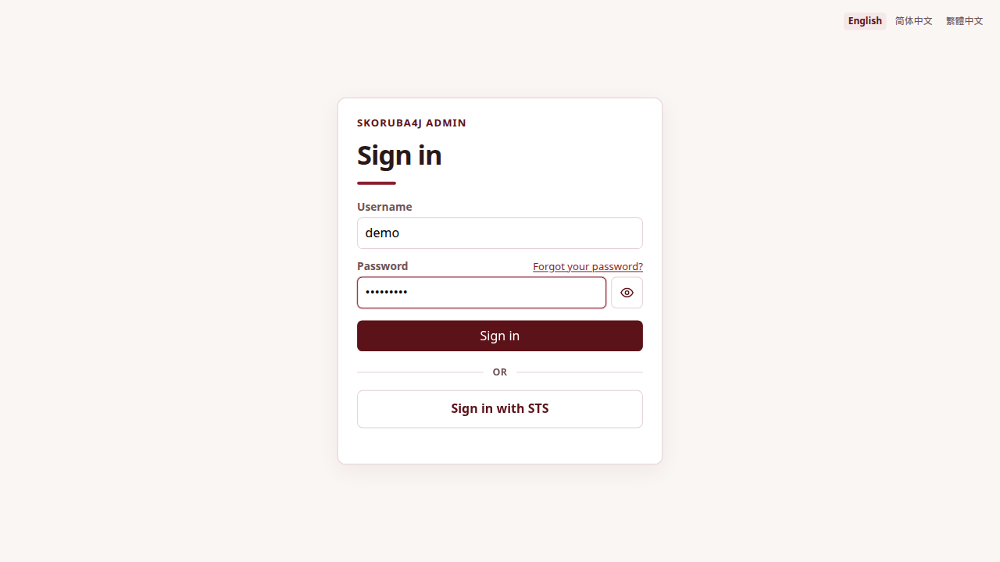
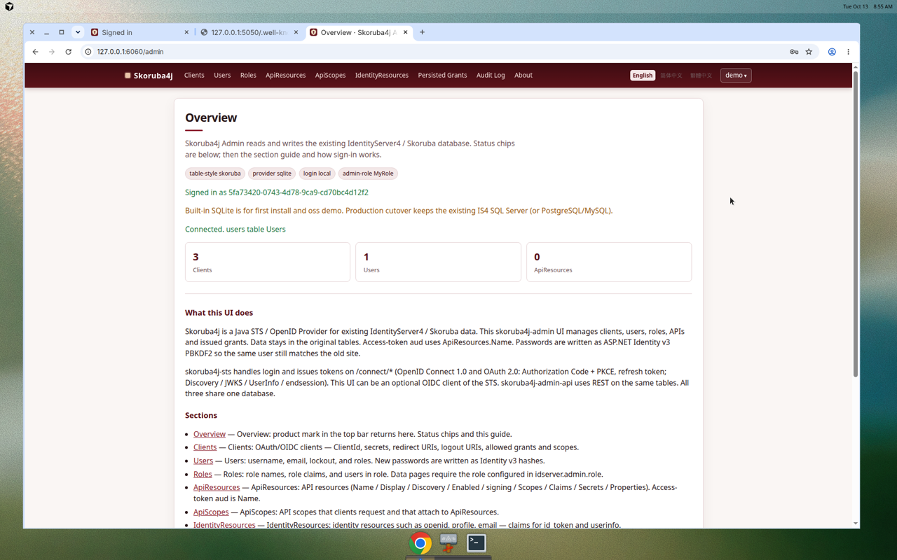
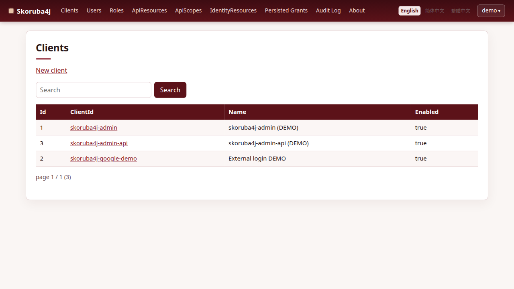
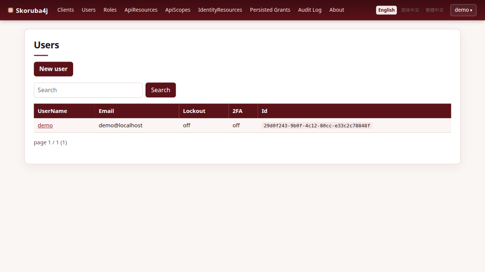
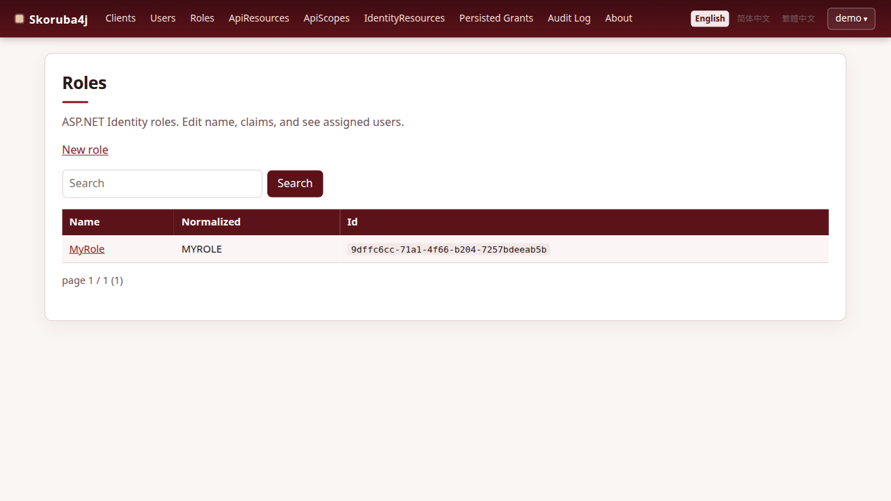
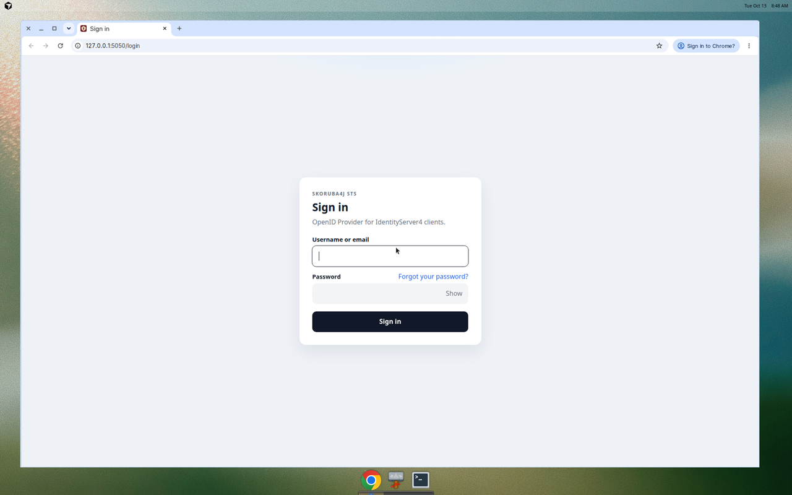
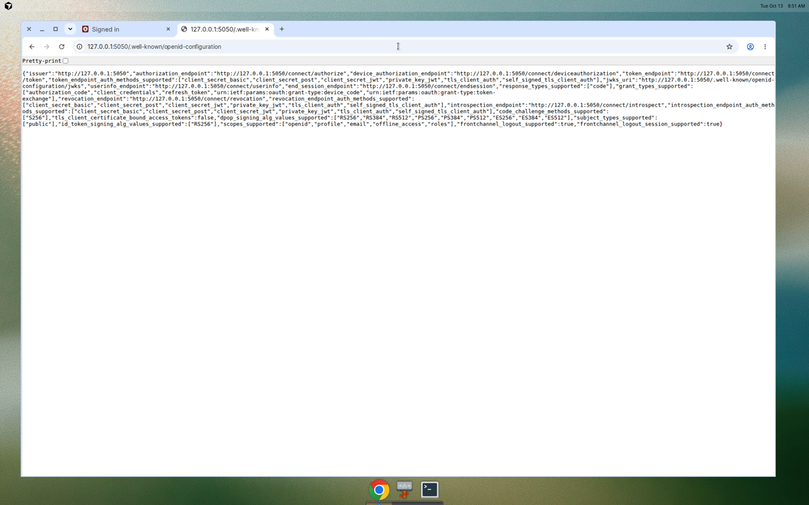
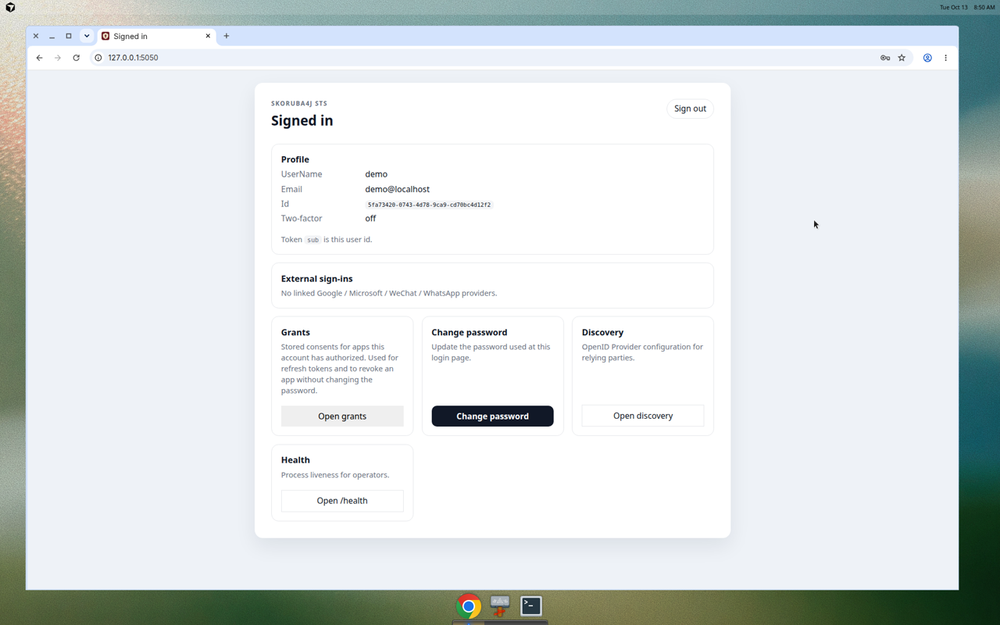

# 试跑 Skoruba4j

这是公开 profile `oss` 的本地演示：STS（以及可选的 Admin）使用**内置 SQLite**。第一次启动会创建数据库文件和 DEMO 用户。这不是生产用的 IdentityServer4 库。下面的密码**只给演示**。

| 检查 | URL | 你会看到 |
|------|-----|----------|
| 健康检查 | http://127.0.0.1:5050/health | JSON，SQLite 打开后 `database` 为 `UP` |
| 发现文档 | http://127.0.0.1:5050/.well-known/openid-configuration | OpenID Provider 元数据，路径是 `/connect/*` |
| JWKS | http://127.0.0.1:5050/.well-known/openid-configuration/jwks | 第一次启动写到 `IDSERVER_HOME/secrets/` 的签名密钥 |
| 登录 | http://127.0.0.1:5050/login | 用户名 `demo`，密码 `Passw0rd!` |
| 登录后首页 | http://127.0.0.1:5050/ | 该演示用户的资料 |
| Admin | http://127.0.0.1:6060/login | 同一个演示用户。Admin 自己查 Users 表（`login-mode=local`） |

本演示的 issuer 是 `http://127.0.0.1:5050`。请用这个主机名，不要用 `localhost`，这样 Cookie 和发现文档一致。

本演示不包含：HTTPS、SMTP、Google / Microsoft / 微信 / WhatsApp（这些需要密钥，仓库里没有）、Swing 控制台、你现有的 SQL Server 库。把同一套 jar 指到已有 IS4 库，见 [GETTING-STARTED.md](GETTING-STARTED.md) 和英文 [CONFIG.md](../CONFIG.md)。

## Docker Compose

需要 Docker 和 Compose v2。在仓库根目录：

```bash
docker compose up --build
```

第一次构建会在镜像里编译 `skoruba4j-sts` 和 `skoruba4j-admin`（JDK 21）。之后会复用镜像。端口只绑在 `127.0.0.1`。

保持该终端运行，然后打开上表里的 URL。Admin 会等 STS 的健康检查通过再启动。

Ctrl+C 停止，然后：

```bash
docker compose down
```

丢掉演示库和签名密钥：

```bash
docker compose down -v
```

SQLite 在 Compose 卷 `demo-home` 里，不会进 Git。

## JDK 21，`java -jar`

不用 Docker。`JAVA_HOME` / `PATH` 必须是 JDK 21。第一次还需要 Git：SQLite 驱动是公开快照 `com.myano:jsqlite:0.1.0-SNAPSHOT`（不在 Maven Central）。本机还没有这个 jar 时，脚本会安装 [JSQLite](https://github.com/Myanowu/jsqlite) 修订 `90f7ede35801a60cd3ea9e206a03d5cf68b35c14`。若旁边已有名为 `JSQLite` 或 `jsqlite` 的检出，就用那个，不再克隆。克隆下来的源码留在被 Git 忽略的 `demo/runtime/` 里。

```bash
./demo/run.sh
```

脚本会打包 `skoruba4j-sts`（跳过测试；CI 仍会跑测试），把运行目录写到被 Git 忽略的 `demo/runtime/`，再启动 jar。覆盖配置是 [../../demo/idserver-demo.yml](../../demo/idserver-demo.yml)。

健康检查：http://127.0.0.1:5050/health

Admin，另开一个终端：

```bash
./demo/run.sh admin
```

http://127.0.0.1:6060/login

可选 Admin API（同一个目录，HTTP 44302）：

```bash
./demo/run.sh admin-api
```

Windows 命令提示符，在仓库根目录：

```bat
demo\run.cmd
demo\run.cmd admin
```

Ctrl+C 停止进程。删掉 `demo/runtime/` 会从空库重新开始。不要提交这个目录。

### Windows 安装包（`dist\cmd`）

在 Windows 上 `mvnw.cmd package` 还会把 JDK 复制到 `dist\jdk`，启动脚本复制到 `dist\cmd`。这些脚本会调用 `env.cmd`，把 `IDSERVER_HOME` 设为 `dist` 目录（`cmd` 的上一级），再用自带的 `java.exe` 启动 jar。Linux / macOS 对应 `dist/cmd/start-sts.sh` 和 `dist/cmd/start-admin.sh`：有 `dist/jdk` 就用它，否则用 `PATH` 上的 `java`。`./demo/run.sh` 不依赖这棵目录。

## 登录并要一个 token

浏览器打开 http://127.0.0.1:5050/login，用 `demo` / `Passw0rd!` 登录。首页会显示这个用户名。Admin 用同一对账号：http://127.0.0.1:6060/login，登录后是 http://127.0.0.1:6060/admin。

空库会种一个**公开**客户端 `skoruba4j-admin`（`RequireClientSecret` 为 false），授权类型是 `authorization_code` 和 `password`。没有客户端密钥可复制。下面的 curl 是演示用的密码模式，不是生产客户端：

```bash
curl -s -X POST http://127.0.0.1:5050/connect/token \
  -H 'Content-Type: application/x-www-form-urlencoded' \
  -d 'grant_type=password' \
  -d 'client_id=skoruba4j-admin' \
  -d 'username=demo' \
  -d 'password=Passw0rd!' \
  -d 'scope=openid profile email roles'
```

成功时 JSON 里有 `access_token`，`token_type` 为 `Bearer`。授权码 + PKCE 已实现，但本演示没有附带示例依赖方。种下的重定向 URI 指向 Admin（`http://127.0.0.1:6060/signin-oidc`）。本演示里的 Admin 不走这个重定向，它在本地校验密码。

访问令牌的 `aud` 是 `ApiResources.Name`，前提是库里有 API 资源。空演示种子不会插入 API 资源，所以在载入真实 IS4 配置库之前，不要期待资源 audience。

## 页面长什么样

Admin 是本演示的控制台。打开 http://127.0.0.1:6060/login，用 `demo` / `Passw0rd!` 登录（写在这里是因为这是本地种子账号）。



概览页统计种子客户端和演示用户。这份空库里的 ApiResources 是 0：



客户端、用户和角色都是同一份种子数据：







5050 端口上的 STS 是令牌签发方。它的登录页接受同一个演示用户：



发现文档：



登录之后，STS 首页显示演示用户，并链到发现文档和健康检查：



## 重置

Docker：`docker compose down -v`，再 `docker compose up --build`。

`java -jar`：停掉进程，删除 `demo/runtime/`（若你自己设置了 `IDSERVER_HOME`，删那个目录）。下次启动会新建文件；只有 `Users` 为空时才会再次写入 DEMO 用户。

英文说明：[../demo.md](../demo.md)。
